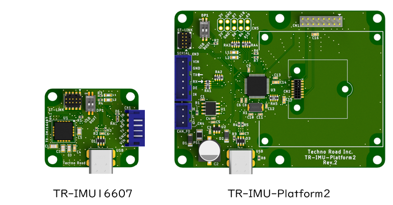

# TR-IMU2-STM32

このリポジトリは、`TR-IMU-Platform2` および `TR-IMU16607` を対象とした IMU ファームウェアのソースコードです。

ターゲット MCU は `STM32U535CCT6` です。STM32CubeIDE ベースで構成されており、IMU 制御、姿勢推定、各種通信機能の実装を含みます。

## 基板の外観



---

## 最新リリース

最新版は [Latest Release](https://github.com/technoroad/TR-IMU2-STM32/releases/latest) からダウンロードできます。

## 概要

- `TR-IMU-Platform2` / `TR-IMU16607` 向けファームウェアのソースコードを管理
- 複数の ADIS 系 IMU に対応
- MCU 側で姿勢推定を実行
- `USB CDC`、`UART`、`CAN FD` によるホスト通信に対応
- ソフトウェアからブートローダへ遷移可能

## 対象ハードウェア

- `TR-IMU-Platform2`
- `TR-IMU16607`

同一コードベースで、上記 2 機種を対象としたファームウェアを管理しています。

### ハードウェア差異

| ハードウェア | 対応IMU | 基板外形(mm) | USB | UART | CANFD |
| --- | --- | --- | --- | --- | --- |
| `TR-IMU-Platform2` | 複数の ADIS 系 IMU に対応 | 横 80.0 x 縦 60.0 | 〇 | 〇 | 〇 |
| `TR-IMU16607` | `ADIS16607-2` 実装済み | 横 35.0 x 縦 30.0 | 〇 | 〇 | × |

## 対応 IMU

以下は `TR-IMU-Platform2` で対応している IMU の一覧です。

| 世代 | IMU | 搭載方法 |
| --- | --- | --- |
| 旧世代 | `ADIS16470/PCBZ` | 基板に直接設置可能 |
| 旧世代 | `ADIS16475-2/PCBZ` | 基板に直接設置可能 |
| 旧世代 | `ADIS16477-2/PCBZ` | 基板に直接設置可能 |
| 旧世代 | `ADIS16495` | [ADIS16IMU1/PCBZ](https://www.analog.com/jp/resources/evaluation-hardware-and-software/evaluation-boards-kits/eval-adis16imu1.html) が必要で、基板に設置不可 |
| 旧世代 | `ADIS16500/PCBZ` | 基板に直接設置可能 |
| 旧世代 | `ADIS16505-2/PCBZ` | 基板に直接設置可能 |
| 新世代 | `ADIS16575` | 基板に直接設置可能 |
| 新世代 | `ADIS16607-2/PCBZ` | 基板に直接設置可能 |

センサ種別は起動時に判定され、製品 ID やモデルに応じて制御方式や感度設定が切り替わります。

## 姿勢推定フィルタ

- `VQF Double`（初期設定）
- `VQF Mixed`
- `VQF Float`
- `MKAE`
- `Fusion`

`VQF`（Versatile Quaternion-based Filter）は、ジャイロセンサと加速度センサの計測値を統合し、クォータニオンで姿勢を推定するフィルタです。静止判定に加え、動作中と静止中の両方でジャイロバイアスを推定し、長時間にわたる安定した姿勢推定を重視した設計です。本ファームウェアのVQF実装は、組み込み機器向けのC実装である [vqf-c](https://github.com/DusKing1/vqf-c) を基にしています。

`MKAE` は、ジャイロセンサと加速度センサを使用する姿勢推定アルゴリズムです。センサ計測値をフィルタリングした後、相補フィルタを用いてクォータニオン姿勢を推定します。静止判定とジャイロバイアス推定の機能も備えています。

[Fusion](https://github.com/xioTechnologies/Fusion) は、x-io Technologiesが公開している組み込み機器向けのセンサフュージョンライブラリです。改良版Madgwick AHRSを使用し、シンプルなクォータニオンベースの姿勢推定を行います。

## 通信インターフェース

- `USB CDC`
- `UART`
- `CAN FD`

初期設定では `USB CDC` と `UART` が有効、`CAN FD` は無効です。

## 関連ツール

- 設定と動作確認アプリ: [technoroad/IMU_PlatformTool2](https://github.com/technoroad/IMU_PlatformTool2)
- Python テストアプリ: [technoroad/TR-IMU2-PythonTestApp](https://github.com/technoroad/TR-IMU2-PythonTestApp)

ファームウェアの設定、通信確認、評価には上記ツールを利用できます。

## ディレクトリ構成

```text
Core/                       STM32CubeIDE が生成するメインコード
Drivers/                    STM32 HAL / CMSIS
STM32_USB_Device_Library/   USB デバイスライブラリ
USB_Device/                 USB CDC 関連
User/app/                   アプリケーション制御、IMU 選択、フィルタ選択
User/communication/         コマンド処理、ACK 送信、CAN FD 受信
User/filter/                姿勢推定フィルタ実装
User/hardware/              SPI / UART / FDCAN / Flash / Bootloader 遷移
User/imu/                   ADIS 系 IMU 制御
User/option/                補助ライブラリ、USB 出力、共通定義
```

## 開発環境

- IDE: [STM32CubeIDE](https://www.st.com/ja/development-tools/stm32cubeide.html)
- ターゲット MCU: `STM32U535CCT6`
- プロジェクト形式: `STM32CubeIDE` / `.ioc` ベース
- 書き込み・デバッグ: `ST-LINK` 対応デバッガを使用

本リポジトリには `STM32CubeIDE` プロジェクト一式と `.ioc` 設定が含まれており、そのままインポートして開発できます。IMU の接続先や通信設定、フィルタ設定などは、コードおよび設定値を調整して利用してください。

## ライセンス

Techno Road Inc. が著作権を有する部分は [MIT License](LICENSE.md) で公開されています。第三者コンポーネントには個別のライセンスが適用されます。

- `vqf-c`: Copyright (c) 2024 Hugo Chiang、[MIT License](User/filter/vqf/LICENSE.md)
- `MKAE`: Copyright (c) 2019 Ken Masuya、[MIT License](User/filter/mkae/LICENSE.md)
- `Fusion`: Copyright (c) 2021 x-io Technologies、[MIT License](User/filter/fusion/LICENSE.md)
